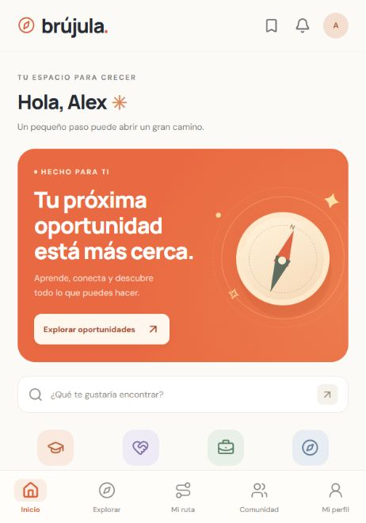

# Brújula · Tu próximo paso

MVP web de KindTech con interfaz móvil. En un celular ocupa la pantalla; en escritorio presenta un marco de teléfono. Nombre provisional. Es pública: no requiere cuenta, inicio de sesión ni instalar nada.

**[Abrir Brújula](https://alejandro-castillo-eng.github.io/brujula-kindtech/)** · [Repositorio](https://github.com/Alejandro-Castillo-eng/brujula-kindtech)



## Lo que funciona

- Inicio, perfil de tres pasos, objetivo y disponibilidad semanal.
- Catálogo inicial de 14 oportunidades recopiladas de fuentes originales, con modalidad, costo, requisitos, enlace y fecha de revisión.
- Búsqueda por palabras, tipo, gratuidad y modalidad. Reconoce expresiones sencillas como «cursos gratis virtuales de marketing» mediante reglas, sin IA.
- Guardados y seguimiento: guardada, en proceso, postulada y completada.
- Ruta orientativa de cinco pasos, progreso persistente y descarga de texto.
- Catálogo personal: crear, editar, guardar borradores, publicar y eliminar oportunidades propias.
- Comunidad: perfil de mentor propio y solicitudes a tres mentores de demostración, señalados como tales, que permiten simular una aceptación.
- Opiniones, exportación de perfil/guardados/progreso/solicitudes/oportunidades propias y eliminación de datos.

## Arquitectura

Sitio estático: React + TypeScript compilado con Vite y publicado en GitHub Pages. No hay servidor, base de datos ni inicio de sesión.

Todos los datos de cada persona (perfil, guardados, progreso, oportunidades propias, solicitudes y opiniones) se guardan **solo en su navegador** (`localStorage`). No se envían a ningún sitio. Si la persona borra los datos del navegador o cambia de dispositivo, empieza de cero; puede descargar una copia con «Exportar mis datos».

| Archivo | Contenido |
|---|---|
| `app/main.tsx`, `index.html` | Punto de entrada |
| `app/mobile-app.tsx` | Navegación y vistas |
| `app/forms.tsx` | Formularios |
| `app/style.css` | Diseño |
| `lib/local-store.ts` | Almacenamiento local, validación (Zod) y reglas de cada acción |
| `lib/logic.ts` | Filtros, vigencia, relevancia y rutas |
| `lib/catalog.json` | Catálogo inicial con su evidencia y fuentes |
| `.github/workflows/pages.yml` | Comprueba, compila y publica en la rama `gh-pages` |

Para cambiar el catálogo inicial basta con editar `lib/catalog.json` y subir el cambio a `main`: GitHub Pages se actualiza solo en uno o dos minutos.

## Desarrollo local

Requiere Node 22.18 o superior.

```bash
npm ci
npm run dev
```

## Verificación

```bash
npm run typecheck
npm test
npm run build
```

Las pruebas cubren filtros, vencimientos en horario de Lima, rutas, validación de URLs y el almacenamiento local (persistencia, validación, catálogo personal, progreso, mentoría de demostración y eliminación de datos). La misma verificación se ejecuta en GitHub Actions en cada cambio.

## Publicación

Cada push a `main` comprueba y compila la app, y publica el resultado en la rama `gh-pages`, que GitHub Pages sirve en https://alejandro-castillo-eng.github.io/brujula-kindtech/. Si el sitio no aparece, revisa **Settings → Pages → Source: Deploy from a branch → `gh-pages` / `(root)`**.

## Límites de esta entrega

Al no haber servidor, los datos no se comparten entre personas ni dispositivos. Los mentores son de ejemplo: las solicitudes no llegan a nadie, y las opiniones se quedan en el navegador de quien las escribe. Una comunidad real o recoger opiniones requerirá un backend o un servicio externo.

La IA generativa no está conectada. No se presenta el filtro por palabras como un modelo de IA. La propuesta y estimación están en `docs/RECOMENDACION_IA.md`; integrarla necesitaría un servidor que guarde la clave de API, porque no puede ponerse en un sitio público.

La revisión de fuentes es manual. Las convocatorias con fecha conocida desaparecen de las búsquedas al vencer; las fechas desconocidas exigen revisión. No hay extracción automática ni garantía de vigencia.

## Operación del piloto

1. Revisar cada semana las fuentes del catálogo; para convocatorias con cierre cercano, revisar con mayor frecuencia.
2. Leer requisitos, costo, ubicación y fecha de cierre en la fuente antes de publicar. No inventar una fecha ausente.
3. Invitar a cinco estudiantes a completar su perfil, encontrar una oportunidad, guardarla y avanzar un paso. Observar dónde se atascan y recoger su opinión.
4. Evaluar si encuentran algo relevante, cuánto tardan, si vuelven y si llegan a participar. La utilidad aún es una hipótesis.
5. Explorar un piloto financiado por una universidad o institución, con acceso básico gratuito para estudiantes. Es una hipótesis de financiación, no un ingreso confirmado.

El alojamiento, la curación y el soporte deben presupuestarse aparte de los tokens de IA. No se implementaron pagos porque aún no hay un modelo de negocio validado.
